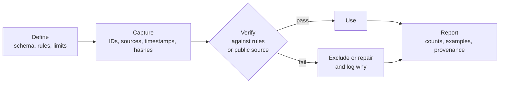

# traceability-casework

[](https://github.com/Diegox1208/traceability-casework/actions/workflows/tests.yml)

Three small, reproducible cases of one working method: **define the record, capture it with
its provenance, check it against rules or public sources, and exclude or repair what fails.**
Each case runs on public or clearly labelled synthetic data, and the tests check that every
seeded fault is found and nothing else is flagged.

*Diego G. Salas*

## Workflow



| Case | Define | Capture | Verify | Data |
|---|---|---|---|---|
| [1. Chain of custody](docs/custody_scheme.md): cord-blood unit, collection to cryostorage | 7 steps, 8 rules | ISBT 128 IDs, hand-offs, temperature logs | each unit traced back to its donor and consent | synthetic, 12 units |
| [2. Verification register](register/register_demo.tsv): market figures | 12 figures with year and unit | source URL, retrieval time, SHA-256 of the raw response | World Bank API, ±5 % | public |
| [3. Patient records](docs/patient_data_model.md): retinal screening | data model, 6 anonymisation rules, 15 QC checks | HMAC pseudonyms, k-anonymity log | QC on pseudonymised tables | public (UCI) + synthetic exams |

## Results

From `bash run.sh` (outputs in [`results/`](results/)):

| Case | Outcome |
|---|---|
| 1. Custody | 12 units checked: 5 traceable end to end, 7 with a break. The 8 seeded faults (7 units + 1 orphan event) were all detected, with 0 false alarms. |
| 2. Register | Of 12 figures, 9 were confirmed and used. 3 were excluded: one quoted the 2022 health-expenditure value as 2023 (8.2 % off), and two had no public source, including an illustrative cord-blood price. |
| 3. Records | 71,518 patients / 101,766 encounters pseudonymised. k-min rose from 1 to 5 by suppressing 14 patients (0.02 %). QC found 5,567 encounters with invalid ICD-9 codes, **all** explained by lost leading zeros (038 stored as 38), so all are repairable. It also found 1,948 patients without ethnicity and 3 with invalid sex. All 28 seeded exam faults were found. |

## What is real and what is synthetic

- **Real, public:** the World Bank figures for Peru (case 2) and the UCI encounter records (case 3).
- **Synthetic:** the custody records (case 1), because no public chain-of-custody data for cord blood exist, and the retinal exams (case 3), because the UCI data have no images. Both are generated from a fixed seed, and their faults are seeded on purpose.
- **Illustrative:** claims C11 and C12 in the register have no source by design.

These are demonstration numbers. They do not describe any real biobank, company or clinic.

## Reproduce

```bash
python -m venv .venv && .venv/bin/pip install -r requirements.txt   # Windows: .venv\Scripts\
.venv/bin/python -m pytest                                         # 21 tests, under a second
PYTHON=.venv/bin/python bash run.sh                                # whole pipeline, ~10 s
OFFLINE=1 PYTHON=.venv/bin/python bash run.sh                      # register from cached responses
DRY_RUN=1 bash run.sh                                              # print commands only
export TRACE_HMAC_KEY=...                                          # stable pseudonyms across runs
```

Only the Python standard library is used at run time; `pytest` and `python-stdnum` are for the
tests (`python-stdnum` is an independent ISO 7064 implementation used as a cross-check).
Every threshold lives in [`config/config.sh`](config/config.sh).

## Layout

```
config/config.sh          thresholds, paths, source URL and SHA-256
run.sh                    stages 01-04, logged to results/run_log.tsv
workflow/                 one script per stage
traceability/             isbt128, custody, register, anonymise, qc, and the synthetic generators
register/                 the figures to verify
data/demo/custody/        synthetic custody records + seeded_faults.tsv
data/cache/worldbank/     raw API responses with retrieval metadata
results/                  reports and summaries
tests/                    pytest suite; fixtures/ holds the API responses used offline
docs/                     custody scheme, patient data model
```

## Sources and licences

- Strack B, DeShazo JP, Gennings C, et al. Impact of HbA1c measurement on hospital readmission rates: analysis of 70,000 clinical database patient records. *BioMed Res Int.* 2014;2014:781670. doi:10.1155/2014/781670. Dataset: UCI Machine Learning Repository, doi:10.24432/C5230J, CC BY 4.0. The dataset is downloaded at run time, not redistributed.
- World Bank, World Development Indicators API, CC BY 4.0. The cached responses are included with attribution.
- FACT/NetCord. *NetCord-FACT International Standards for Cord Blood Collection, Banking, and Release for Administration*, 8th ed. (storage ≤ −150 °C; collection to processing ≤ 48 h).
- ICCBBA. *ISBT 128 Standard*: Donation Identification Number and ISO/IEC 7064 MOD 37-2 check character.

Code: [MIT](LICENSE).
