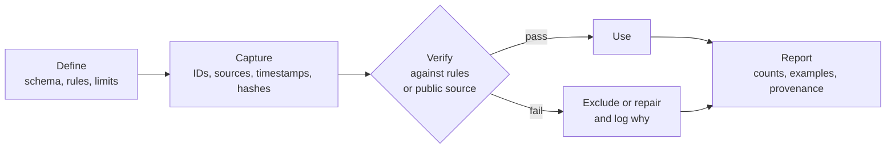

# traceability-casework

[](https://github.com/Diegox1208/traceability-casework/actions/workflows/tests.yml)

Three small, reproducible cases of one working method. Define the record, capture it with
its provenance, check it against rules or public sources, and exclude or repair what fails.
Each case runs on public or clearly labelled synthetic data, and the tests check that every
seeded fault is found and nothing else is flagged.

*Diego G. Salas*

## Workflow



<table>
<thead><tr><th>Case</th><th>Define</th><th>Capture</th><th>Verify</th><th>Data</th></tr></thead>
<tbody><tr><td><a href="docs/custody_scheme.md">1. Chain of custody</a> of a cord-blood unit, collection to cryostorage</td><td>7 steps, 8 rules</td><td>ISBT 128 IDs, hand-offs, temperature logs</td><td>each unit traced back to its donor and consent</td><td>synthetic, 12 units</td></tr></tbody>
<tbody><tr><td><a href="register/register_demo.tsv">2. Verification register</a> of market figures</td><td>12 figures with year and unit</td><td>source URL, retrieval time, SHA-256 of the raw response</td><td>World Bank API, ±5 %</td><td>public</td></tr></tbody>
<tbody><tr><td><a href="docs/patient_data_model.md">3. Patient records</a> for retinal screening</td><td>data model, 6 anonymisation rules, 15 QC checks</td><td>HMAC pseudonyms, k-anonymity log</td><td>QC on pseudonymised tables</td><td>public UCI records plus synthetic exams</td></tr></tbody>
</table>

## Results

Numbers below come from `bash run.sh`, with outputs in [`results/`](results/).

### Case 1, custody

<table>
<thead><tr><th>Units checked</th><th>Traceable end to end</th><th>With a break</th><th>Seeded faults</th><th>Detected</th><th>False alarms</th></tr></thead>
<tbody><tr><td>12</td><td>5</td><td>7</td><td>8</td><td>8</td><td>0</td></tr></tbody>
</table>

The eight seeded faults are seven faulty units and one orphan event.

### Case 2, register

<table>
<thead><tr><th>Figures</th><th>Confirmed and used</th><th>Excluded</th><th>Largest discrepancy among the confirmed</th></tr></thead>
<tbody><tr><td>12</td><td>9</td><td>3</td><td>8.2 %</td></tr></tbody>
</table>

Of the three excluded, one quoted the 2022 health-expenditure value as 2023, which is the 8.2 % discrepancy, and two had no public source, including an illustrative cord-blood price.

### Case 3, records

<table>
<thead><tr><th>Patients</th><th>Encounters</th><th>k-min before</th><th>k-min after</th><th>Patients suppressed</th></tr></thead>
<tbody><tr><td>71 518</td><td>101 766</td><td>1</td><td>5</td><td>14</td></tr></tbody>
</table>

<table>
<thead><tr><th>Encounters with invalid ICD-9 codes</th><th>Of them repairable</th><th>Patients without ethnicity</th><th>Patients with invalid sex</th><th>Seeded exam faults</th><th>Found</th></tr></thead>
<tbody><tr><td>5 567</td><td>5 567</td><td>1 948</td><td>3</td><td>28</td><td>28</td></tr></tbody>
</table>

The 14 suppressed patients are 0.02 % of the table. Every invalid ICD-9 code is explained by a lost leading zero, 038 stored as 38, so all are repairable.

## What is real and what is synthetic

- Real and public. The World Bank figures for Peru in case 2 and the UCI encounter records in case 3.
- Synthetic. The custody records in case 1, because no public chain-of-custody data for cord blood exist, and the retinal exams in case 3, because the UCI data have no images. Both are generated from a fixed seed, and their faults are seeded on purpose.
- Illustrative. Claims C11 and C12 in the register have no source by design.

These are demonstration numbers. They do not describe any real biobank, company or clinic.

## Reproduce

```bash
python -m venv .venv && .venv/bin/pip install -r requirements.txt   # on Windows use .venv\Scripts\
.venv/bin/python -m pytest                                         # 21 tests, under a second
PYTHON=.venv/bin/python bash run.sh                                # whole pipeline, ~10 s
OFFLINE=1 PYTHON=.venv/bin/python bash run.sh                      # register from cached responses
DRY_RUN=1 bash run.sh                                              # print commands only
export TRACE_HMAC_KEY=...                                          # stable pseudonyms across runs
```

Only the Python standard library is used at run time. `pytest` and `python-stdnum` are for the
tests, where `python-stdnum` is an independent ISO 7064 implementation used as a cross-check.
Every threshold lives in [`config/config.sh`](config/config.sh).

## Layout

```
config/config.sh          thresholds, paths, source URL and SHA-256
run.sh                    stages 01-04, logged to results/run_log.tsv
workflow/                 one script per stage
traceability/             isbt128, custody, register, anonymise, qc, and the synthetic generators
register/                 the figures to verify
data/demo/custody/        synthetic custody records + seeded_faults.tsv
data/cache/worldbank/     raw API responses with retrieval metadata
results/                  reports and summaries
tests/                    pytest suite, fixtures/ holds the API responses used offline
docs/                     custody scheme, patient data model
```

## Sources and licences

- Strack B, DeShazo JP, Gennings C, et al. Impact of HbA1c measurement on hospital readmission rates. Analysis of 70,000 clinical database patient records. *BioMed Res Int.* 2014, vol. 2014, article 781670. DOI 10.1155/2014/781670. Dataset in the UCI Machine Learning Repository, DOI 10.24432/C5230J, CC BY 4.0. The dataset is downloaded at run time, not redistributed.
- World Bank, World Development Indicators API, CC BY 4.0. The cached responses are included with attribution.
- FACT/NetCord. *NetCord-FACT International Standards for Cord Blood Collection, Banking, and Release for Administration*, 8th ed. Storage at or below −150 °C, collection to processing within 48 h.
- ICCBBA. *ISBT 128 Standard*, Donation Identification Number and ISO/IEC 7064 MOD 37-2 check character.

Code under the [MIT licence](LICENSE).
