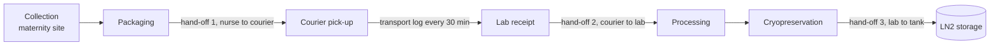

# Chain-of-custody scheme for a cord-blood unit, from collection to cryostorage

The scheme answers one question for any stored unit. **Who held it, where, at what temperature,
and which donor and consent it belongs to.** The validator in `traceability/custody.py`
implements it and `workflow/01_custody.py` runs it on synthetic records.

## Sample path

## Records

| Table | Field | Meaning |
|---|---|---|
| `units.tsv` | `din`, `check` | ISBT 128 Donation Identification Number and its ISO 7064 MOD 37-2 check character |
| | `donor_id` | donor pseudonym (the key to the donor record is held apart) |
| | `consent_id` | consent record that authorises banking |
| | `collection_site` | where the unit was collected |
| `events.tsv` | `event_id`, `din`, `step`, `timestamp` | one row per step, ISO 8601 with time zone |
| | `location`, `from_custodian`, `to_custodian` | who handed the unit to whom, and where |
| | `signed_by` | signature of the person releasing the unit |
| `temperature_log.tsv` | `din`, `phase`, `timestamp`, `temp_c` | logger readings in transport and in storage |

## Rules

| Rule | Check | Limit |
|---|---|---|
| R1 | DIN well formed, check character correct | ISBT 128 |
| R2 | unit linked to donor pseudonym and consent, DIN unique | — |
| R3 | all seven steps recorded once, in order | — |
| R4 | giver of each step = receiver of the previous step, hand-offs signed | — |
| R5 | transport readings inside the SOP range | 15–25 °C (demonstration value, set per SOP) |
| R6 | storage readings at or below the limit | ≤ −150 °C (NetCord-FACT) |
| R7 | collection to processing | ≤ 48 h (NetCord-FACT) |
| R8 | no event for an unregistered unit | — |

A unit is **traceable** only if it passes all of R1–R7. Every limit is a parameter in
`config/config.sh`.

## Demonstration data

The records are **synthetic** (`traceability/custody_demo.py`, seed 2026), with 12 units, 84 events,
187 temperature readings, facility code `Z9999` (fictional). Seven units carry one seeded fault
each and one event refers to an unregistered unit. `data/demo/custody/seeded_faults.tsv` is the
ground truth the tests compare against.
