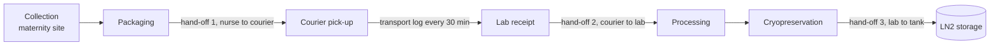

# Chain-of-custody scheme for a cord-blood unit, from collection to cryostorage

The scheme answers one question for any stored unit. Who held it, where, at what temperature,
and which donor and consent it belongs to. The validator in `traceability/custody.py`
implements it and `workflow/01_custody.py` runs it on synthetic records.

## Sample path

## Records

<table>
<thead><tr><th>Table</th><th>Field</th><th>Meaning</th></tr></thead>
<tbody><tr><td><code>units.tsv</code></td><td><code>din</code>, <code>check</code></td><td>ISBT 128 Donation Identification Number and its ISO 7064 MOD 37-2 check character</td></tr></tbody>
<tbody><tr><td></td><td><code>donor_id</code></td><td>donor pseudonym, the key to the donor record is held apart</td></tr></tbody>
<tbody><tr><td></td><td><code>consent_id</code></td><td>consent record that authorises banking</td></tr></tbody>
<tbody><tr><td></td><td><code>collection_site</code></td><td>where the unit was collected</td></tr></tbody>
<tbody><tr><td><code>events.tsv</code></td><td><code>event_id</code>, <code>din</code>, <code>step</code>, <code>timestamp</code></td><td>one row per step, ISO 8601 with time zone</td></tr></tbody>
<tbody><tr><td></td><td><code>location</code>, <code>from_custodian</code>, <code>to_custodian</code></td><td>who handed the unit to whom, and where</td></tr></tbody>
<tbody><tr><td></td><td><code>signed_by</code></td><td>signature of the person releasing the unit</td></tr></tbody>
<tbody><tr><td><code>temperature_log.tsv</code></td><td><code>din</code>, <code>phase</code>, <code>timestamp</code>, <code>temp_c</code></td><td>logger readings in transport and in storage</td></tr></tbody>
</table>

## Rules

<table>
<thead><tr><th>Rule</th><th>Check</th><th>Limit</th></tr></thead>
<tbody><tr><td>R1</td><td>DIN well formed, check character correct</td><td>ISBT 128</td></tr></tbody>
<tbody><tr><td>R2</td><td>unit linked to donor pseudonym and consent, DIN unique</td><td>none</td></tr></tbody>
<tbody><tr><td>R3</td><td>all seven steps recorded once, in order</td><td>none</td></tr></tbody>
<tbody><tr><td>R4</td><td>giver of each step = receiver of the previous step, hand-offs signed</td><td>none</td></tr></tbody>
<tbody><tr><td>R5</td><td>transport readings inside the SOP range</td><td>15–25 °C, a demonstration value set per SOP</td></tr></tbody>
<tbody><tr><td>R6</td><td>storage readings at or below the limit</td><td>≤ −150 °C, NetCord-FACT</td></tr></tbody>
<tbody><tr><td>R7</td><td>collection to processing</td><td>≤ 48 h, NetCord-FACT</td></tr></tbody>
<tbody><tr><td>R8</td><td>no event for an unregistered unit</td><td>none</td></tr></tbody>
</table>

A unit is traceable only if it passes all of R1–R7. Every limit is a parameter in
`config/config.sh`.

## Demonstration data

The records are synthetic, generated by `traceability/custody_demo.py` with seed 2026, with 12 units, 84 events,
187 temperature readings and the fictional facility code `Z9999`. Seven units carry one seeded fault
each and one event refers to an unregistered unit. `data/demo/custody/seeded_faults.tsv` is the
ground truth the tests compare against.
