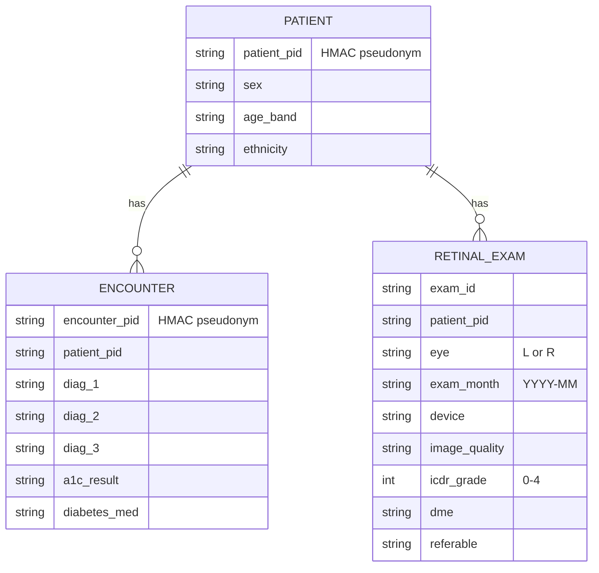

# Patient-record data model, anonymisation rules and QC for retinal screening

Designed for screening diabetic patients in a polyclinic network. Tested on the public
UCI *Diabetes 130-US hospitals* dataset, 101 766 encounters of 71 518 diabetic patients,
which has the layout of a real hospital extract. It contains no retinal images, so the
exam table is synthetic.

## Model

`referable` means ICDR grade 2 or above, moderate non-proliferative or worse, or diabetic macular oedema.

## Anonymisation rules

<table>
<thead><tr><th>#</th><th>Rule</th><th>How</th></tr></thead>
<tbody><tr><td>A1</td><td>Direct identifiers never leave the intake step</td><td><code>patient_nbr</code> and <code>encounter_id</code> are replaced by HMAC-SHA256 pseudonyms of 16 hex characters. The key comes from <code>TRACE_HMAC_KEY</code> and is never stored in the repository</td></tr></tbody>
<tbody><tr><td>A2</td><td>Keep only what screening needs</td><td><code>weight</code>, <code>payer_code</code>, <code>medical_specialty</code> and the medication columns are dropped</td></tr></tbody>
<tbody><tr><td>A3</td><td>Dates coarsened</td><td>exam dates kept as year-month</td></tr></tbody>
<tbody><tr><td>A4</td><td>Quasi-identifiers generalised</td><td>age widened from 10- to 20-year bands</td></tr></tbody>
<tbody><tr><td>A5</td><td>k-anonymity</td><td>patients whose class of sex, age band and ethnicity has fewer than k = 5 members are suppressed</td></tr></tbody>
<tbody><tr><td>A6</td><td>QC runs on pseudonymised data</td><td>reports cite pseudonyms only</td></tr></tbody>
</table>

## QC checks

<table>
<thead><tr><th>Rule</th><th>Table</th><th>Check</th></tr></thead>
<tbody><tr><td>Q1</td><td>encounters</td><td>identifier unique</td></tr></tbody>
<tbody><tr><td>Q2</td><td>patients</td><td>sex is Female or Male</td></tr></tbody>
<tbody><tr><td>Q3</td><td>patients</td><td>ethnicity recorded</td></tr></tbody>
<tbody><tr><td>Q4</td><td>patients</td><td>age band well formed</td></tr></tbody>
<tbody><tr><td>Q5</td><td>encounters</td><td>length of stay 1–14 days</td></tr></tbody>
<tbody><tr><td>Q6</td><td>encounters</td><td>primary diagnosis recorded</td></tr></tbody>
<tbody><tr><td>Q7</td><td>encounters</td><td>diagnoses are valid ICD-9 codes</td></tr></tbody>
<tbody><tr><td>Q7b</td><td>encounters</td><td>invalid code explained by lost leading zeros, repairable</td></tr></tbody>
<tbody><tr><td>Q8</td><td>encounters</td><td>HbA1c result uses the coded values</td></tr></tbody>
<tbody><tr><td>Q9</td><td>encounters</td><td>refers to a known patient</td></tr></tbody>
<tbody><tr><td>X1</td><td>retinal exams</td><td>refers to a known patient</td></tr></tbody>
<tbody><tr><td>X2</td><td>retinal exams</td><td>eye is L or R</td></tr></tbody>
<tbody><tr><td>X3</td><td>retinal exams</td><td>gradable → grade 0–4, ungradable → no grade</td></tr></tbody>
<tbody><tr><td>X4</td><td>retinal exams</td><td>referable flag agrees with grade and DME</td></tr></tbody>
<tbody><tr><td>X5</td><td>retinal exams</td><td>one exam per patient, eye and month</td></tr></tbody>
</table>
