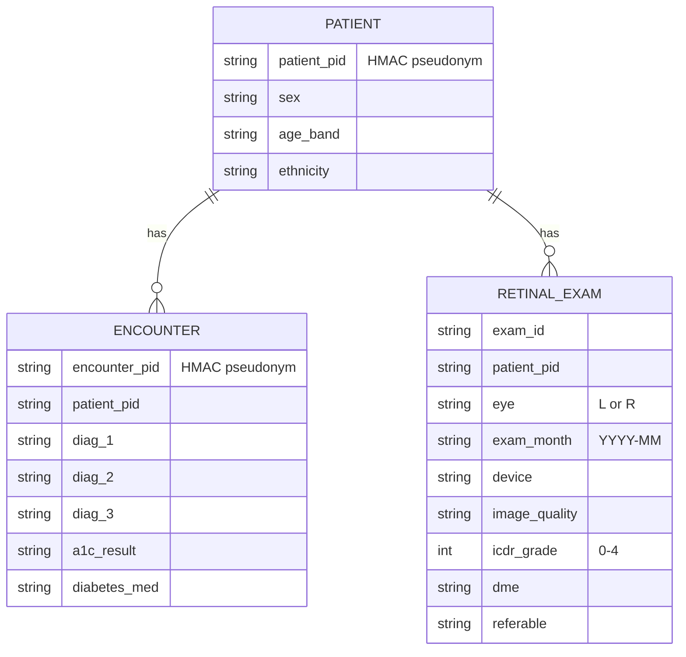

# Patient-record data model, anonymisation rules and QC for retinal screening

Designed for screening diabetic patients in a polyclinic network. Tested on the public
UCI *Diabetes 130-US hospitals* dataset (101,766 encounters of 71,518 diabetic patients),
which has the layout of a real hospital extract. It contains no retinal images, so the
exam table is synthetic.

## Model

`referable` = ICDR grade ≥ 2 (moderate non-proliferative or worse) or diabetic macular oedema.

## Anonymisation rules

| # | Rule | How |
|---|---|---|
| A1 | Direct identifiers never leave the intake step | `patient_nbr`, `encounter_id` replaced by HMAC-SHA256 pseudonyms (16 hex). The key comes from `TRACE_HMAC_KEY` and is never stored in the repository |
| A2 | Keep only what screening needs | `weight`, `payer_code`, `medical_specialty` and the medication columns are dropped |
| A3 | Dates coarsened | exam dates kept as year-month |
| A4 | Quasi-identifiers generalised | age widened from 10- to 20-year bands |
| A5 | k-anonymity | patients whose (sex, age band, ethnicity) class has fewer than k = 5 members are suppressed |
| A6 | QC runs on pseudonymised data | reports cite pseudonyms only |

## QC checks

| Rule | Table | Check |
|---|---|---|
| Q1 | encounters | identifier unique |
| Q2 | patients | sex is Female or Male |
| Q3 | patients | ethnicity recorded |
| Q4 | patients | age band well formed |
| Q5 | encounters | length of stay 1–14 days |
| Q6 | encounters | primary diagnosis recorded |
| Q7 | encounters | diagnoses are valid ICD-9 codes |
| Q7b | encounters | invalid code explained by lost leading zeros (repairable) |
| Q8 | encounters | HbA1c result uses the coded values |
| Q9 | encounters | refers to a known patient |
| X1 | retinal exams | refers to a known patient |
| X2 | retinal exams | eye is L or R |
| X3 | retinal exams | gradable → grade 0–4, ungradable → no grade |
| X4 | retinal exams | referable flag agrees with grade and DME |
| X5 | retinal exams | one exam per patient, eye and month |
